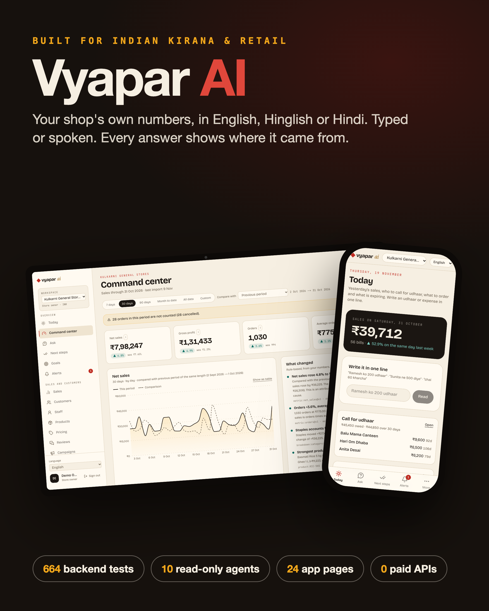
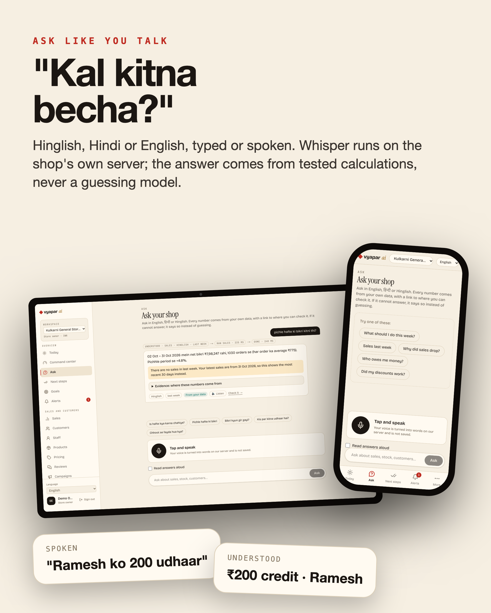
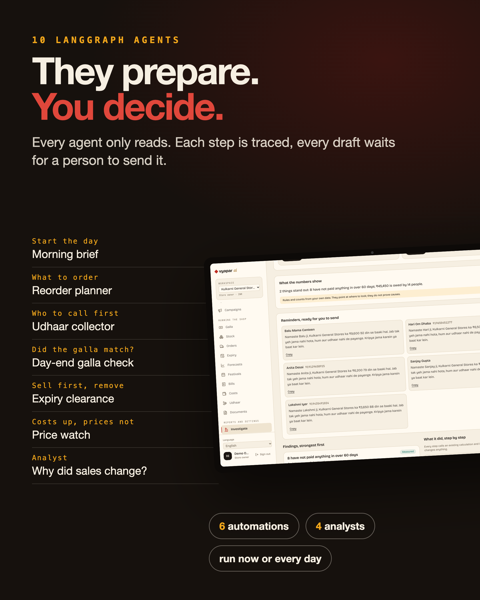

<div align="center">

# ◆ Vyapar AI

**Decision support for Indian small and mid-sized retailers.**
Bring your sales in. See what happened and why, what is likely next, and which action is worth taking, in English, Hindi or Hinglish, by typing or by speaking.

[](https://github.com/SDP42/vyaparai/actions/workflows/ci.yml)


</div>

> **Honest status.** Every planned phase has a working first version, and a full user journey is covered by an
> automated test. Nothing has yet been tested with real shopkeepers, real recorded speech or real shop data;
> every accuracy figure in this repository comes from synthetic or self-written test sets and says so where it
> is quoted. See [What is not proven yet](#what-is-not-proven-yet).

---

## Contents

1. [Overview](#overview)
2. [What it does](#what-it-does)
3. [Who sees what: jobs in the shop](#who-sees-what-jobs-in-the-shop)
4. [Ask in your own words, or speak](#ask-in-your-own-words-or-speak)
5. [Architecture](#architecture)
6. [Technology and licences](#technology-and-licences)
7. [Quick start](#quick-start)
8. [Configuration](#configuration)
9. [Repository layout](#repository-layout)
10. [Quality: tests, static checks, audits](#quality-tests-static-checks-audits)
11. [Security and privacy](#security-and-privacy)
12. [Measured results and limits](#measured-results-and-limits)
13. [What is not proven yet](#what-is-not-proven-yet)
14. [Roadmap and status](#roadmap-and-status)
15. [Documentation index](#documentation-index)
16. [Engineering principles](#engineering-principles)
17. [Contributing](#contributing)

---

## Overview

Small retailers already have the data: billing exports, spreadsheets, stock lists, a credit notebook. What they lack
is the time and the vocabulary to turn it into decisions. Vyapar AI converts that data into **trusted metrics**,
**honest forecasts**, **plain-language explanations** and **suggestions a person approves**.

Three commitments shape every feature:

- **Every number traces to a calculation.** One versioned metric registry feeds dashboards, the API, the reports
  and the assistant. Nothing in the product invents a figure, and there is no language model writing answers:
  the assistant routes a question to a tested tool and quotes what the tool returned.
- **People stay in charge.** The product suggests; a person decides, approves and sends. Nothing is ordered,
  messaged or changed automatically.
- **It says what it does not know.** Forecasts report how wrong they have been, answers carry the evidence behind
  them, and each feature's limits are written beside it.

It is built for Indian retail: day-first dates and lakh/crore formatting, festival and regional calendars, Hindi
and Hinglish text, WhatsApp-style messages sent by a person, udhaar (shop credit), and tooling that runs on a
laptop for free.

It is **not** a billing or accounting system, a marketplace, or an autonomous agent. It reads exports from the
tools a shop already uses.

<p align="center">
  
  
  
</p>

More screenshots of every page are in [docs/linkedin/images](docs/linkedin/images/).

---

## What it does

| Area | Capabilities | Docs |
|---|---|---|
| **Every day** | A Today page (last day's sales, who to call for udhaar, what to order, what is expiring); the galla: a day-end cash count with expected against counted; expenses; supplier order lists to share; one-line entries such as "Ramesh ko 200 udhaar" read back before saving | [DAILY](docs/DAILY.md) |
| **Data in** | CSV and Excel upload, header detection, remembered column mappings, row-level validation with a downloadable error file, idempotent import, connected Google Sheet or shared-file links with scheduled re-imports, optional Cashier/Staff column | [DATA_DICTIONARY](docs/DATA_DICTIONARY.md) |
| **Trusted numbers** | One metric registry with versions; period comparisons; price-volume-mix drivers that sum exactly to the change; drill-through to the transactions | [METRICS](docs/METRICS.md) |
| **Customers and products** | RFM segments, cohorts, ABC classes, margin and discount analysis, portfolio quadrants, basket pairs | [DATA_DICTIONARY](docs/DATA_DICTIONARY.md) |
| **Forecasting** | Statistical, intermittent-demand and gradient-boosted models; per-series model choice; rolling backtests; conformal ranges; a ship gate and rollback; festival, regional and weather signals tested before use | [MODELS](docs/MODELS.md) |
| **Stock** | Days of cover from the forecast, order-now advice by safety level, dead stock, cash tied up, a downloadable order list | [research/INVENTORY](docs/research/INVENTORY.md) |
| **Margins and costs** | Cost history read from every sale, leaks where cost rose faster than price (with a suggested price), supplier price rises | [research/COST-TRACKING](docs/research/COST-TRACKING.md) |
| **Purchase bills** | Photo or PDF of a supplier bill read by OCR, checked by a person line by line, then costs and supplier price changes stay current | [BILLS](docs/BILLS.md) |
| **Udhaar** | Credit ledger with FIFO ageing, who to chase first, reminder drafts in Hinglish, English or Hindi for you to send | [UDHAAR](docs/UDHAAR.md) |
| **Alerts and digest** | Fixed-rule alerts (sales drop, margin leak, stock-out risk, regulars drifting away, rising complaints); a daily or weekly three-numbers-and-one-action digest by email | [research/ALERTS](docs/research/ALERTS.md), [research/DIGEST](docs/research/DIGEST.md) |
| **Festivals** | 320 dated events with region matching, forecast signals and "stock before" warnings | [EVENTS](docs/EVENTS.md) |
| **Campaigns** | Segment audiences, margin-guarded offers, drafted messages, consent and opt-out, a person-sent WhatsApp outbox with a daily cap, holdout design and uplift measured with confidence ranges | [CAMPAIGN-RUNS](docs/CAMPAIGN-RUNS.md) |
| **Reviews** | Language, sentiment and themes for English, Hindi and Hinglish reviews, with the phrase behind every claim | [REVIEWS](docs/REVIEWS.md) |
| **Pricing and goals** | Which discounts paid off (against the same weekday, in profit after the discount), small safe price trials; targets with pace and a likely-finish range | [PRICING](docs/PRICING.md), [GOALS](docs/GOALS.md) |
| **Next steps and reports** | Ranked recommendations with impact ranges, assumptions and outcome tracking; saved PDF/CSV summaries for an accountant or partner (amounts print with ₹) | [RECOMMENDATIONS](docs/RECOMMENDATIONS.md) |
| **Agents** | Ten bounded, traced LangGraph workflows over existing services, no language model in the loop: four analysts ("why did sales change?", weekly review, customer health, stock risk) and six automations that can run every morning (morning brief, reorder planner, udhaar collector, day-end check, expiry clearance, price watch) and prepare drafts for you to send | [AGENTS](docs/AGENTS.md), [agents/](agents/) |
| **Documents** | Search your own policies and supplier terms with cited passages (PDF, DOCX, TXT) | [DOCUMENTS](docs/DOCUMENTS.md) |
| **Staff** | Sales by cashier or salesperson (bills, average bill, items per bill, discount, margin); counter staff see only their own | [PERSONAS](docs/PERSONAS.md) |
| **Several shops** | Side-by-side comparison on growth, margin and order value; each shop keeps its own data and team | [STORES](docs/STORES.md) |
| **Phones** | Installable PWA with offline reading, a phone-style bottom bar, Hinglish and Hindi for navigation, the assistant and the credit pages | [MOBILE](docs/MOBILE.md) |

The end-to-end journey (sign up, import, numbers, forecast, alerts, digest, stock advice, invite a teammate) is
covered by [`test_mvp_journey.py`](apps/api/tests/test_mvp_journey.py). The [MVP checklist](docs/MVP.md) lists what
is ready and what is not.

---

## Who sees what: jobs in the shop

A shop is several jobs, not one user. Each member has a **role** (what they may change) and, optionally, a
**persona** (the job they do, which decides what they are meant to see and ask).

| Persona | Role it fits | Sees | May ask the assistant about | Never sees |
|---|---|---|---|---|
| **Store owner** | owner | everything | everything | |
| **Operations manager** | admin and above | sales, stock, forecasts, bills, udhaar, reviews, reports, staff | sales, stock, forecasts, alerts, suppliers, festivals, udhaar, next steps | margin and cost, customer lists, pricing |
| **Data analyst** | analyst and above | analytics, customers, margins, pricing, reviews, reports, staff | analytics, customers, margin, suppliers, pricing, reviews | the credit book |
| **Accountant** (view only) | viewer and above | sales, pricing, bills, costs, udhaar, reports | sales, margin, suppliers, udhaar, goals | customers, stock detail |
| **Counter staff** | viewer and above | ask, products, stock, documents, festivals, own sales | stock and price of a product, what sells, today's sales | profit, credit, suppliers, other people's sales |

It is enforced on the server, not only in the menu: the assistant refuses out-of-remit questions before any tool
runs (in the asker's language, naming who can answer), sensitive routes require a capability, and cost and margin
fields are emptied per field for personas without the margin capability. See [PERSONAS](docs/PERSONAS.md).

With `DEMO_LOGIN_ENABLED=true` (development only) the sign-in page offers the five people as real sample accounts.

---

## Ask in your own words, or speak

The assistant understands English, Hindi (Devanagari) and Hinglish, including the way spoken Hindi comes back from
speech recognition (spelt by ear), spoken amounts (`दो हज़ार पाँच सौ`, `डेढ़ सौ`, `ek lakh pachas hazaar`) and Hindi
product names (`चावल`, `बासमती राइस`) matched to an English catalogue, with "did you mean" buttons when unclear.

**Voice** is built for people who would rather speak than type:

```
browser: tap → record → stops after a pause → 16 kHz mono WAV, made in the browser
  → POST /assistant/voice   (your own server; audio in memory only, never stored or logged)
  → length and loudness checks → faster-whisper (Whisper medium, int8, CPU), language hint, voice-activity detection
  → silence "hallucinations", wrong scripts and prompt echoes dropped
  → text back → shown as "I heard: …" to confirm or fix → then the normal question flow
  → answer shown, optionally read aloud by the device's own voice
```

Speech to text runs on your server with a free, MIT-licensed multilingual model; nothing is sent to a third party.
See [VOICE](docs/VOICE.md) for the failure modes it guards against and the measured results.

---

## Architecture

```
 Browser (Next.js 15, TypeScript, Tailwind 4)
        │  HTTPS · access token in memory · rotating HttpOnly refresh cookie
        ▼
 FastAPI  /api/v1     hardening middleware: headers · size limits · per-address rate limits
   routers ─► services ─► repositories ─► SQLAlchemy 2 models ─► SQLite (dev) / PostgreSQL (prod)
      │           │
      │           ├─ analytics · metric registry · drivers · customers · products · staff
      │           ├─ forecasting · engine · backtests · registry · signals (festivals, weather)
      │           ├─ ingestion · connectors · costs · bills (OCR) · inventory · alerts · digest
      │           ├─ campaigns · reviews NLP · documents (retrieval) · udhaar · pricing · goals
      │           ├─ assistant · nlu · tools · evidence · numbers · translit · personas · voice
      │           ├─ daily · galla · expenses · expiry · order lists · quick entries
      │           └─ agents (LangGraph: 4 analysts, 6 automations, daily schedule) · recommendations · reports · runners
      ▼
 Every tenant-owned row carries workspace_id; membership is checked on every request
```

A **modular monolith**: small domain modules, one deployable unit, one database. Routers translate HTTP, services
own transactions and rules, repositories own queries. Design notes are in [ARCHITECTURE](docs/ARCHITECTURE.md) and
the [decision records](docs/adr/); the data model is in [DATA_DICTIONARY](docs/DATA_DICTIONARY.md).

Key design decisions:

- **Workspace as tenant.** A non-member gets a 404, not a 403, so workspace ids cannot be probed ([ADR 0003](docs/adr/0003-workspace-tenancy.md)).
- **One metric layer.** Business dates are stored, drivers sum exactly, definitions are versioned ([ADR 0006](docs/adr/0006-metric-layer.md)).
- **Baselines before models.** A forecasting model ships only if it beats repeating last week on a time-aware backtest ([ADR 0007](docs/adr/0007-ml-approach.md)).
- **No generative model in the answer path.** Text from reviews or documents is only ever data, so nothing hidden in it can steer the product.
- **Sessions.** 15-minute access token in memory; HttpOnly refresh cookie that rotates, with reuse detection, an idle and an absolute limit ([ADR 0004](docs/adr/0004-jwt-bearer-auth.md)).

---

## Technology and licences

Only free software with permissive licences is used. A test fails if a disallowed licence enters the dependency
tree; reviewed exceptions are listed with their reasons in [LICENSES](docs/LICENSES.md).

| Layer | Choices |
|---|---|
| API | Python 3.12, FastAPI, Pydantic 2, SQLAlchemy 2, Alembic, uv, PyJWT, Argon2 (pwdlib), pg8000 (PostgreSQL), Redis client |
| Data and ML | NumPy, LightGBM, our own statistical and intermittent-demand models with conformal intervals, LangGraph, fastembed (multilingual MiniLM, ONNX), RapidOCR |
| Speech | faster-whisper with the Whisper `medium` weights (MIT); PyAV is deliberately not installed because its wheels bundle GPL codecs ([LICENSES](docs/LICENSES.md)) |
| Documents and reports | pypdf and pypdfium2, openpyxl, DOCX read from its zip with a size guard, reportlab with bundled Noto Sans (SIL OFL) |
| Web | Next.js 15 (standalone output), React 19, Tailwind 4, GSAP, Lenis, Motion, Recharts, lucide-react; types generated from the API with openapi-typescript |
| Quality | pytest, ruff, strict mypy, `tsc --noEmit`, `node --test`, pip-audit, npm audit |
| Run | Docker Compose (API, web, PostgreSQL, Redis), backup and restore scripts, GitHub Actions CI |

The web app has no image, video, model or sound assets for its landing page: the opening is drawn in SVG and CSS.

---

## Quick start

**Prerequisites:** Python 3.12+, [uv](https://docs.astral.sh/uv/), Node 22+. About 3 GB of disk for the speech model
and the document-search model if you use voice and document search.

```bash
# 1. API: http://localhost:8000/docs
cd apps/api
cp .env.example .env
uv sync
uv run alembic upgrade head
uv run fastapi dev app/main.py --port 8000
```

```bash
# 2. Web: http://localhost:3000   (second terminal)
cd apps/web
cp .env.example .env.local
npm install
npm run dev
```

From the repository root: `make api`, `make web`, `make test`, `make lint`, `make gen-api`.

### Try each job with one tap

Set `DEMO_LOGIN_ENABLED=true` in `apps/api/.env` (development only; the API refuses to start in production with it
on). The sign-in page then offers the five people, each a real account with its own persona in one sample shop.

### Try it with sample data

1. Sign in as the owner, or create your own account.
2. **Import sales data → Try the sample file**, and follow the wizard.
3. Explore the command center, customers, products, forecasts, alerts, stock and udhaar.
4. Sample files live in [`data/sample/`](data/sample/); regenerate them with `python scripts/generate_demo_data.py`.

### Voice

The first spoken question downloads the Whisper weights into the Hugging Face cache (about 1.5 GB for `medium`).
Set `STT_MODEL=small` for a faster, lighter and less accurate model, `STT_LOCAL_FILES_ONLY=true` on a server that
must never fetch weights, or `VOICE_ENABLED=false` to switch voice off. The browser needs microphone permission.

### Production-shaped stack

```bash
cp .env.production.example .env    # fill in POSTGRES_PASSWORD, JWT_SECRET_KEY (48+ chars), PUBLIC_URL, PUBLIC_API_URL
docker compose up -d --build
```

The API refuses to start if production settings are unsafe (short secret, SQLite, non-https origins, demo login on).
See [RUNBOOK](docs/RUNBOOK.md) for backups, restore checks, upgrades and incidents. This stack has not yet been
rehearsed on a real server.

---

## Configuration

Settings are read from environment variables (and `apps/api/.env`). The full annotated list is
[`apps/api/.env.example`](apps/api/.env.example); the ones you are most likely to touch:

| Variable | Default | Purpose |
|---|---|---|
| `APP_ENV` | `development` | `development`, `test` or `production` (production turns on strict guards) |
| `DATABASE_URL` | `sqlite:///./vyapar_dev.db` | SQLite for development, PostgreSQL (`postgresql+pg8000://…`) for production |
| `JWT_SECRET_KEY` | dev value | Must be 32+ random characters in production |
| `CORS_ORIGINS`, `APP_URL` | `http://localhost:3000` | Must be https in production |
| `REDIS_URL` | none | Shared rate-limit store; without it limits are per process |
| `DEMO_LOGIN_ENABLED` | `false` | One-tap sample accounts per persona; refused in production |
| `VOICE_ENABLED`, `STT_MODEL` | `true`, `medium` | Speech to text; model size or a local folder |
| `STT_LOCAL_FILES_ONLY`, `VOICE_MAX_SECONDS` | `false`, `15` | Offline weights; longest spoken question |
| `HEAVY_RATE_LIMIT_PER_MINUTE` | `60` | Uploads, search, questions, voice, investigations, reports |
| `SMTP_HOST` … `SMTP_FROM` | none | Digest and reminder email delivery |
| `OPEN_METEO_API_KEY` | none | Weather signals; the free tier is non-commercial, so production needs a paid key |

---

## Repository layout

```
apps/
  api/                    FastAPI service
    app/
      api/v1/endpoints/   routers (one file per area) · api/masking.py (per-field hiding) · api/deps.py
      services/           business rules, one module or package per area
        assistant/        nlu · tools · replies · evidence · numbers · translit · personas gating
        analytics/ forecasting/ ingestion/ reviews/ docs/ bills/ agents/ recommend/ reports/
        personas.py voice.py demo.py team.py credit.py inventory.py …
      models/ schemas/ repositories/ core/ db/ assets/fonts/
    alembic/versions/     migrations (batch mode for SQLite)
    tests/                664 tests, including tenancy, sessions, hardening and a licence audit
    scripts/              export_openapi.py
    openapi.json          checked by a test so it cannot go stale
  web/
    app/                  Next.js routes: landing, login, join, offline, /app/* (24 pages)
    components/           landing/ · opening/ (cloth and ribbon) · app/ (pages, shell, voice) · ui/
    lib/                  api client, generated api-types.ts, i18n (en · hinglish · hi), wav and speech helpers
    tests/                node tests: service worker simulation, audio helpers
    public/               manifest, service worker, icons
data/sample/              synthetic demo exports (regenerated by scripts/generate_demo_data.py)
docs/                     product, engineering, research and decision records
scripts/                  demo data generator, voice evaluation, accessibility audit, backup and restore
docker-compose.yml        API, web, PostgreSQL, Redis
```

---

## Quality: tests, static checks, audits

```bash
cd apps/api && .venv/bin/python -m pytest          # 664 tests, about 6 minutes
cd apps/api && .venv/bin/python -m ruff check . && .venv/bin/python -m mypy app
cd apps/web && npm run lint && npm test && npm run build
```

- **Tests (664):** unit and API tests across every area, tenancy isolation (a non-member sees a 404 everywhere),
  session security (rotation, reuse detection, throttling), hostile uploads that must never produce a server error,
  prompt-injection strings stored as text, persona remit for every assistant intent, response masking, the full MVP
  journey, and a licence audit of both dependency trees.
- **Static checks:** strict `mypy` on the application, `ruff` for lint and format, `tsc --noEmit` for the web app.
- **Generated contract:** `openapi.json` is compared with the live API in a test; web types are generated from it.
- **Audits (2026-11-11):** `pip-audit` found no known vulnerabilities in the production Python set; `npm audit`
  reports PostCSS inside Next 15, which processes our own stylesheets at build time and is accepted until Next 16.
- **Accessibility:** a purpose-written audit script ([`scripts/a11y-audit.js`](scripts/a11y-audit.js)) was run on the
  landing page, sign-in and all 24 app pages; findings and fixes are in [ACCESSIBILITY](docs/ACCESSIBILITY.md).
- **CI** runs lint, types, tests with coverage, the web build and the dependency audit on every push.

---

## Security and privacy

Server-side workspace isolation; Argon2id password hashing; short-lived access tokens kept in memory; rotating
HttpOnly refresh cookies with reuse detection; CSRF guards (custom header plus origin check); throttled sign-in and
registration; security headers; request-size limits (1 MB JSON, 20 MB uploads, about 1 MB for a voice clip);
per-address and "heavy route" rate limits; SSRF-safe link fetching; PostgreSQL statement timeouts; an audit trail
for sensitive actions; production guards that refuse unsafe settings. Customer data stays minimal (an external key
and coarse location); marketing consent is explicit and opt-outs are honoured. Voice audio is processed in memory
and discarded. See the [threat model](docs/THREAT_MODEL.md).

---

## Measured results and limits

Every figure here is from a small synthetic or self-written set and is optimistic; the documents say how.

| Area | Result | Where it is explained |
|---|---|---|
| Forecasts | Shipped models beat "repeat last week" by 28% on the benchmark data, with the gate enforced; intervals close to nominal coverage | [MODELS](docs/MODELS.md) |
| Assistant routing | 100% on a 79-question set that the keyword lists were tuned on (a development set, not a test set) | [ASSISTANT](docs/ASSISTANT.md) |
| Document search | Recall@3 0.98 (easy) and 1.00 (paraphrased) on 57 labelled questions over 12 passages; one out-of-scope question still got a "high" answer | [DOCUMENTS](docs/DOCUMENTS.md) |
| Voice (synthetic speech) | Right intent on 17/17 clean and 15/17 noisy questions with Whisper medium (15 and 13 with small); about 4.3 s per question on a laptop; no words invented from four kinds of silence and noise | [VOICE](docs/VOICE.md) |
| Review sentiment | Reported on a small self-written set; unseen-review accuracy is not measured | [REVIEWS](docs/REVIEWS.md) |

---

## What is not proven yet

- **Real shopkeepers.** No user test of voice, personas, wording or layout. Synthetic voices are clean and accent-free;
  real speech, noise, accents and half-words will do worse. The persona definitions come from general knowledge of
  Indian retail, not interviews.
- **Real shop data.** Review sentiment, bill OCR, document search, pricing advice and recommendation impact have not
  been measured on a real shop's files.
- **Language.** The Hinglish and Hindi wording has not been reviewed by a native speaker. Navigation, the assistant,
  voice, the credit pages and every page's headline and introduction are translated; page bodies are English. PDF
  reports are English (the PDF library cannot shape Devanagari). Voice is tested for Hindi and English only.
- **Deployment.** The Docker stack, backups and restore are written and unit-tested but have not been rehearsed on a
  real server. A real phone (install, microphone, read-aloud) and a real screen reader have not been tried.
- **Decisions that are the owner's:** the project licence, and a trademark check on the name "Vyapar" (an existing
  Indian billing app uses it).

---

## Roadmap and status

| # | Phase | Status |
|---|---|---|
| 0–4 | Foundation, ingestion, metric layer, customers and products, forecasting | ✅ |
| 5–5B | Stock decisions; festivals, regions and cricket | ✅ |
| 6–8 | Review intelligence; document search; the assistant | ✅ |
| 9–10 | Agent workflows; recommendations and reports | ✅ |
| 11 | Hardening and deployment | ✅ code · not rehearsed on a server |
| 12–15B | Digest; udhaar; alerts; connectors; cost tracking and bills | ✅ |
| 16–17 | Pricing advice; several shops and staff | ✅ |
| 18 | Phones, PWA and Hinglish/Hindi | ✅ app · 🟡 wording and page bodies |
| 19 | Goals and benchmarks | ✅ |
| 20 | Personas and voice | ✅ first version |
| 21 | Daily routines and automation agents | ✅ first version |

Next, in order: record real shopkeeper questions and re-measure voice; confirm the persona definitions with real
owners; native review of the Hindi and Hinglish wording and translation of page bodies; a real-phone test; a deployment
rehearsal and restore test; measure review, OCR, search and pricing accuracy on a consenting shop's files; Marathi,
Gujarati, Tamil and Bengali speech. The ticked checklist per phase is in [PHASES](docs/PHASES.md) and the plan in
[ROADMAP](docs/ROADMAP.md).

---

## Documentation index

| Group | Documents |
|---|---|
| **Start here** | [ROADMAP](docs/ROADMAP.md) · [PHASES](docs/PHASES.md) · [MVP](docs/MVP.md) · [DEVLOG](docs/DEVLOG.md) · [CHANGELOG](CHANGELOG.md) |
| **How it is built** | [ARCHITECTURE](docs/ARCHITECTURE.md) · [API](docs/API.md) · [DATA_DICTIONARY](docs/DATA_DICTIONARY.md) · [decision records](docs/adr/) · [RUNBOOK](docs/RUNBOOK.md) |
| **Numbers and models** | [METRICS](docs/METRICS.md) · [MODELS](docs/MODELS.md) · [EVENTS](docs/EVENTS.md) · [REVIEWS](docs/REVIEWS.md) · [PRICING](docs/PRICING.md) · [GOALS](docs/GOALS.md) |
| **Features** | [DAILY](docs/DAILY.md) · [ASSISTANT](docs/ASSISTANT.md) · [VOICE](docs/VOICE.md) · [PERSONAS](docs/PERSONAS.md) · [DOCUMENTS](docs/DOCUMENTS.md) · [AGENTS](docs/AGENTS.md) · [RECOMMENDATIONS](docs/RECOMMENDATIONS.md) · [UDHAAR](docs/UDHAAR.md) · [BILLS](docs/BILLS.md) · [CAMPAIGN-RUNS](docs/CAMPAIGN-RUNS.md) · [STORES](docs/STORES.md) · [MOBILE](docs/MOBILE.md) |
| **Security, licences, quality** | [THREAT_MODEL](docs/THREAT_MODEL.md) · [LICENSES](docs/LICENSES.md) · [ACCESSIBILITY](docs/ACCESSIBILITY.md) |
| **Design** | [DESIGN_SYSTEM](docs/DESIGN_SYSTEM.md) · [frontend notes](docs/frontend/) |
| **Showcase** | [LinkedIn kit](docs/linkedin/README.md): post, slides, screenshots and the [complete project document (PDF)](docs/linkedin/Vyapar-AI-Project-Document.pdf) |
| **Research** | [docs/research/](docs/research/): method research, [what makes the product different](docs/research/DIFFERENTIATION.md), [personas and voice](docs/research/PERSONAS-VOICE.md) |

---

## Engineering principles

1. **SQL metrics over model arithmetic.** One metric registry feeds dashboards, the API, reports and the assistant.
2. **Workspace isolation from day one.** Access is enforced server-side on every request.
3. **Never silently accept bad data.** Rejected rows are counted and downloadable.
4. **Human approval over autonomy.** The product suggests; people decide and send.
5. **Baselines before models.** Complexity must earn its place on a backtest.
6. **Least access by job.** A persona narrows what a person sees and may ask; it never widens a role.
7. **Say what is not known.** Limits are written down next to the feature.

---

## Contributing

See [CONTRIBUTING](CONTRIBUTING.md): Conventional Commits, small focused commits, and the definition of done.
